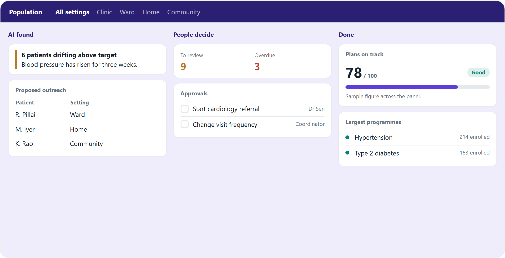

# Example: care team dashboard

A coordinator's view of a programme: who is suggested for enrolment, what needs a decision and what is overdue.



*Mock-up with sample data.*

## Resources

| On screen | Resource | Notes |
|---|---|---|
| Programme | `cohort` definition | A rule decides who is suggested |
| Suggestions | `proposal` | A clinician accepts or rejects each one |
| Members | `cohort_membership` | Enrolment is a clinical decision |
| Work | `task` | Assigned to a role |

Clinestra does not calculate population measures, denominators or care gaps. The application must compute any counts from the records it lists, and label them as such.

## Build the data

```python
from clinestra import Actor, Harness

h = Harness()
SITE = "clinic_1"
admin = Actor(id="admin_1", site=SITE, role="admin")
lead = Actor(id="lead_1", site=SITE, role="clinical_lead")
dr = Actor(id="dr_rao", site=SITE, role="clinician")
coordinator = Actor(id="coord_1", site=SITE, role="coordinator")

# Define the programme. Cohorts need a citation and a review.
cohort = h.create(admin, "definition", {
    "def_kind": "cohort",
    "key": "uncontrolled_htn",
    "name": "Uncontrolled hypertension",
    "config": {
        "rule": "cond_htn and obs_bp_systolic >= 140",
        "manual_only": False,
        "evidence": [{"id": "clinic-sop-1", "title": "Clinic hypertension SOP",
                      "source_type": "local_sop"}],
    },
})
h.review_definition(lead, cohort.id, "approve", review_ref="clinic-sop-1")
h.transition(admin, "definition", cohort.id, "published")

patient = h.create(dr, "patient", {
    "name": "R. Pillai", "country": "IN", "gender": "male", "age_years": 61,
})
h.create(dr, "condition", {"patient_id": patient.id, "code": "htn"})
h.create(coordinator, "observation", {
    "patient_id": patient.id, "code": "bp_systolic", "value": 152,
})

# Matching patients become proposals. A clinician decides.
suggestions = h.suggest_cohorts(dr, patient.id)
assert [s.data["cohort_key"] for s in suggestions] == ["uncontrolled_htn"]
h.accept_proposal(dr, suggestions[0].id)

members = h.list(coordinator, "cohort_membership", status="active",
                 cohort_key="uncontrolled_htn")
assert len(members) == 1

h.create(coordinator, "task", {
    "patient_id": patient.id,
    "title": "Call about home BP readings",
    "assignee_role": "coordinator",
})
```

## Build the screen

| Part | API | UI component |
|---|---|---|
| Find matches | `POST /v1/patients/{id}/suggest-cohorts` for each patient | Your own job |
| To decide | `GET /v1/proposals?status=pending` | `ProposalInbox` |
| Approvals | `GET /v1/approvals?status=pending` | `ApprovalQueue` |
| Members | `GET /v1/cohort-memberships?status=active` | `CohortBoard` |
| Work | `GET /v1/tasks?status=open` | `TaskBoard` |

## Prompt

```text
Build a care team dashboard in React and TypeScript on the Clinestra API.
Read the Clinestra docs first: api_basics, longitudinal_care, ui_components and example_care_team_dashboard.

Screens, as a three-column board:
1. Suggested: pending proposals whose target is cohort_membership, with their rationale.
2. To decide: other pending proposals and approvals.
3. In progress: active cohort members and open tasks, overdue first.

Add a filter by care setting. Use ProposalInbox, ApprovalQueue, CohortBoard and TaskBoard from @clinestra/blocks.
Add a server job that requests cohort suggestions for each patient once a day.

Rules:
- The API is the source of truth. Do not enrol patients in the client. Only accepted proposals enrol them.
- Coordinators can see proposals but only clinicians can accept clinical ones. Show the API's refusal.
- Clinestra has no population measures. Any count you show must come from listed records and be labelled as a simple count, not a quality measure.

Include a seed script based on the Python in example_care_team_dashboard, and a README with run steps.
```
