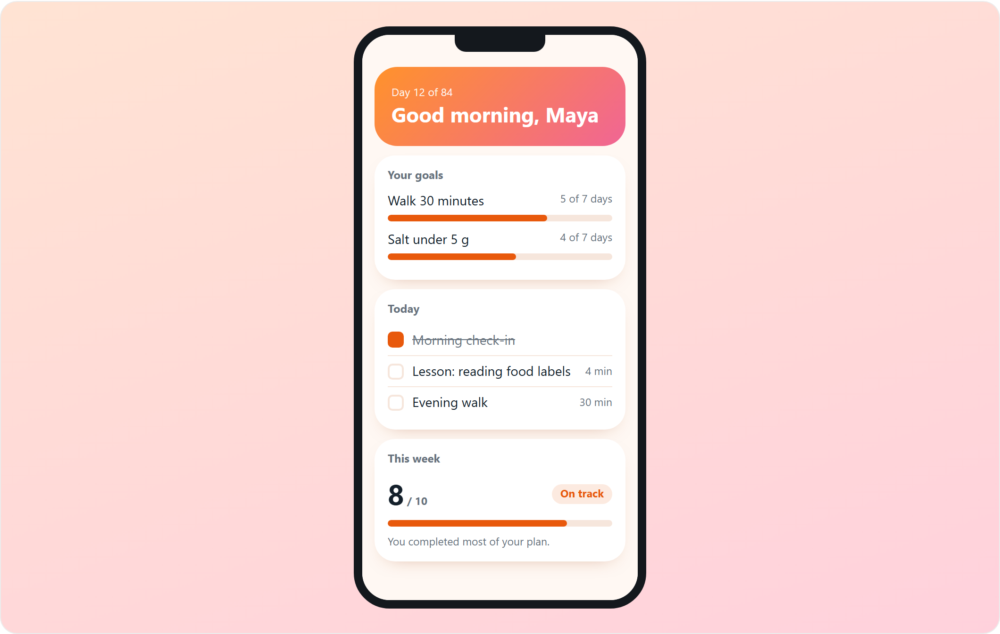

# Example: digital therapeutics

A patient application for a guided programme with daily activities and goals. The care team sees the same data.



*Mock-up with sample data.*

## Resources

| On screen | Resource | Notes |
|---|---|---|
| Programme | `careplan` | Starts as a draft. A clinician activates it. |
| Daily activities | `care_action` | A schedule tracks what is due and missed |
| Check-ins | `journal_entry` | Coded fields become observations |
| Goals | `outcome` | A measure and a target |
| Coach | `conversation` | Needs the patient's AI consent |

## Build the data

```python
from clinestra import Actor, Harness

h = Harness()
SITE = "clinic_1"
dr = Actor(id="dr_rao", site=SITE, role="clinician")

patient = h.create(dr, "patient", {
    "name": "Maya R", "country": "IN", "gender": "female", "age_years": 52,
})
me = Actor(id=patient.id, site=SITE, role="patient", patient_id=patient.id)

# Start the programme from the core pack's hypertension plan.
plan = h.create(dr, "careplan", {"patient_id": patient.id,
                                 "definition_key": "hypertension_basic"})
h.transition(dr, "careplan", plan.id, "active", "Agreed with patient")

# Set a goal.
goal = h.create(dr, "outcome", {
    "patient_id": patient.id,
    "name": "Systolic BP under 130",
    "measure_code": "bp_systolic",
    "comparator": "<",
    "target": 130,
})
assert goal.status == "expected"

# The patient completes today's check-in.
actions = h.list(me, "care_action", patient.id, careplan_id=plan.id)
checkin = next(a for a in actions if a.action_type == "journal")
h.create(me, "journal_entry", {
    "patient_id": patient.id,
    "plugin_key": "vitals_log",
    "care_action_id": checkin.id,
    "data": {"bp_systolic": 128, "bp_diastolic": 82},
})
reading = h.list(dr, "observation", patient.id, code="bp_systolic")[0]
assert reading.value == 128 and reading.perceived_by == "patient"

# What is due, overdue and missed.
status = h.schedule_status(me, checkin.id)
print(status["counts"], status["next_due"])
```

## Build the screen

| Part | API | UI component |
|---|---|---|
| Sign-in | `/v1/portal` routes | Your own form |
| Today | `GET /v1/care-actions?patient_id=...` | Your own list |
| Check-in | `POST /v1/journal-entries` | `JournalLogger` |
| Goals | `GET /v1/outcomes?patient_id=...` | `Blocks` with `care_plan_progress` |
| Coach | `/v1/ai` routes, `conversation` | `ConversationThread` |

Programmes that follow set phases, such as an 84-day course, can add a `journey` definition with one state per phase.

## Prompt

```text
Build a patient-facing digital therapeutics application in React and TypeScript on the Clinestra API.
Read the Clinestra docs first: api_basics, ai_runtime, ui_components and example_digital_therapeutics.

Screens:
1. Sign-in by phone code through the patient portal routes.
2. Today: active care actions with what is due, using the schedule status from the API.
3. Check-in: the journal form for the care action, using JournalLogger.
4. Goals: outcomes and progress from the patient's observations.
5. Coach: a conversation, shown only when the patient has granted ai consent. Use ConsentGate.

Write for patients: short sentences, a reading age of about 12, and no clinical abbreviations.

Rules:
- The API is the source of truth. Do not calculate adherence or schedule status in the client.
- The coach may encourage and explain the existing plan. It must not change doses or give a diagnosis.
- Show the care team's contact details, and tell patients what to do in an emergency.
- When the API refuses a request, show its error message.

Include a seed script based on the Python in example_digital_therapeutics, and a README with run steps.
```
