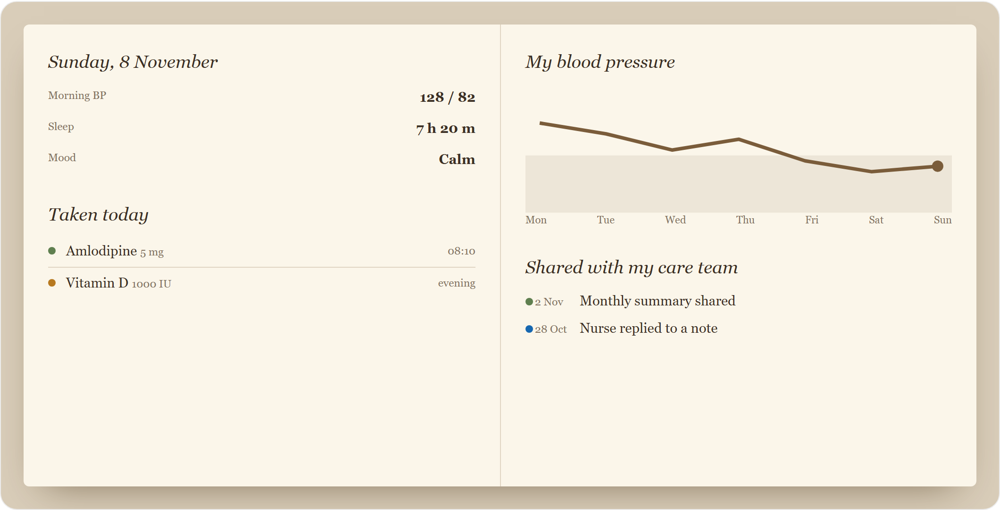

# Example: health journal

A patient-held record of readings and medication. The patient decides whether to share documents with the care team.



*Mock-up with sample data.*

## Resources

| On screen | Resource | Notes |
|---|---|---|
| Log forms | `journal_plugin` definition | The core pack includes `vitals_log` and `medication_taken` |
| Entries | `journal_entry` | Created by the patient |
| Trend | `observation` | Marked `perceived_by: patient` |
| Sharing | `consent` | Scope `data_sharing` |

## Build the data

```python
from clinestra import Actor, Harness

h = Harness()
SITE = "clinic_1"
dr = Actor(id="dr_rao", site=SITE, role="clinician")

patient = h.create(dr, "patient", {
    "name": "Anita P", "country": "IN", "gender": "female", "age_years": 58,
})
me = Actor(id=patient.id, site=SITE, role="patient", patient_id=patient.id)

# The patient logs a week of readings.
for systolic in [136, 134, 131, 133, 129, 127, 128]:
    h.create(me, "journal_entry", {
        "patient_id": patient.id,
        "plugin_key": "vitals_log",
        "data": {"bp_systolic": systolic, "bp_diastolic": 82},
    })

series = h.list(me, "observation", patient.id, code="bp_systolic")
assert len(series) == 7

# The patient records consent to share data.
consent = h.create(me, "consent", {"patient_id": patient.id,
                                   "consent_scope": "data_sharing"})
consent = h.transition(me, "consent", consent.id, "granted", "I agree")
assert consent.status == "granted"
```

## Build the screen

| Part | API | UI component |
|---|---|---|
| Sign-in | `/v1/portal` routes | Your own form |
| Log a reading | `POST /v1/journal-entries` | `JournalLogger` |
| Trend | `GET /v1/observations?patient_id=...&code=...` | `Blocks` with `trend_chart` |
| Sharing | `POST /v1/consents`, then `transition` | `ConsentGate` |
| History | `GET /v1/journal-entries?patient_id=...` | `ActivityTrail` |

Staff at the site can read journal entries. Use `data_sharing` consent to control what leaves the site, such as a shared document.

## Prompt

```text
Build a patient health journal in React and TypeScript on the Clinestra API.
Read the Clinestra docs first: api_basics, clinical_consent, ui_components and example_health_journal.

Screens:
1. Sign-in by phone code through the patient portal routes.
2. Today: a quick log of readings and medication, using JournalLogger with the published journal_plugin definitions.
3. Trends: charts of the patient's observations, with the option to choose a code and date range.
4. Sharing: current consents, with controls to grant and withdraw them.

Build forms from the journal_plugin definitions. Do not hard-code the fields.
Use a warm, paper-like theme.

Rules:
- The API is the source of truth. A patient can see only their own record.
- Be clear about who at the clinic can read an entry. Do not imply a journal is private from the care team.
- Do not interpret readings as a diagnosis or show treatment advice.
- When the API refuses a request, show its error message.

Include a seed script based on the Python in example_health_journal, and a README with run steps.
```
