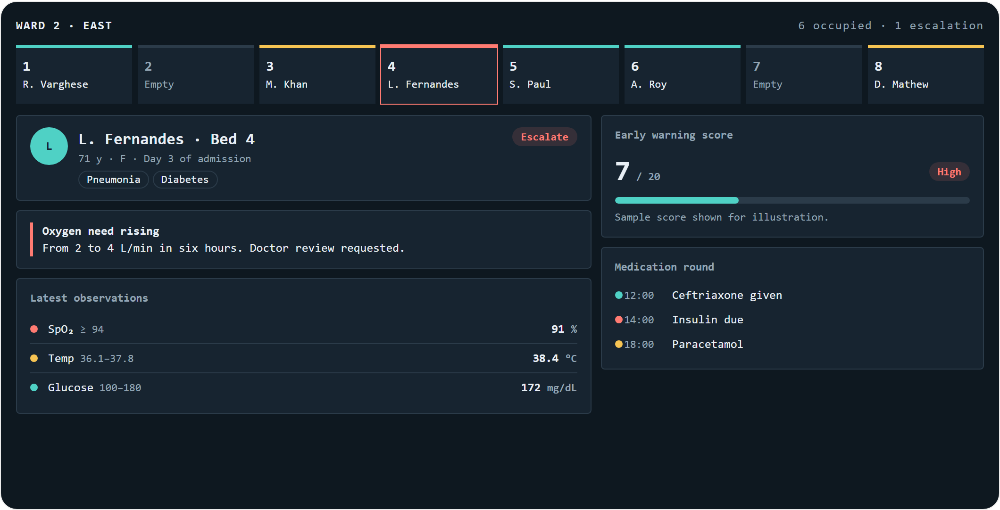

# Example: inpatient ward board

A ward board showing each admitted patient, their latest observations and any escalations. A configured reaction raises an urgent task when a reading crosses a threshold.



*Mock-up with sample data.*

## Resources

| On screen | Resource | Notes |
|---|---|---|
| Ward | `clinical_setting` | Encounters link to it with `setting_id` |
| Bed | `encounter` | Store the bed in the application, or in the encounter's `reason` |
| Observations | `observation` | Latest value per code |
| Escalation | `reaction` definition, `task` | Creates an urgent task for the team |

Clinestra has no bed resource and does not calculate early warning scores by default. Add a score as an `assessment` definition.

## Build the data

```python
from clinestra import Actor, Harness

h = Harness()
SITE = "hospital_1"
admin = Actor(id="admin_1", site=SITE, role="admin")
lead = Actor(id="lead_1", site=SITE, role="clinical_lead")
dr = Actor(id="dr_rao", site=SITE, role="clinician")
nurse = Actor(id="nurse_a", site=SITE, role="nurse")

# Escalate when oxygen saturation is low. Reactions need a citation and a review.
rule = h.create(admin, "definition", {
    "def_kind": "reaction",
    "key": "low_spo2_escalation",
    "name": "Low SpO2 escalation",
    "config": {
        "when_kind": "observation",
        "when_state": "final",
        "condition": "code == 'spo2' and value < 92",
        "effects": [{"op": "create", "kind": "task", "data": {
            "title": "Review low SpO2",
            "priority": "urgent",
            "assignee_role": "clinician",
        }}],
        "evidence": [{"id": "ward-sop-1", "title": "Ward escalation SOP",
                      "source_type": "local_sop"}],
    },
})
h.review_definition(lead, rule.id, "approve", review_ref="ward-sop-1")
h.transition(admin, "definition", rule.id, "published")

ward = h.create(admin, "clinical_setting", {"name": "Ward 2 East", "setting_type": "ward"})
patient = h.create(dr, "patient", {
    "name": "L. Fernandes", "country": "IN", "gender": "female", "age_years": 71,
})
admission = h.create(nurse, "encounter", {
    "patient_id": patient.id,
    "encounter_type": "admission",
    "setting_id": ward.id,
    "reason": "Bed 4. Pneumonia.",
})

h.create(nurse, "observation", {
    "patient_id": patient.id,
    "encounter_id": admission.id,
    "code": "spo2",
    "value": 91,
    "unit": "%",
})

tasks = h.list(dr, "task", patient.id)
assert [(t.title, t.priority) for t in tasks] == [("Review low SpO2", "urgent")]
```

## Build the screen

| Part | API | UI component |
|---|---|---|
| Bed grid | `GET /v1/encounters?status=pending`, filtered by `setting_id` | Your own layout |
| Latest observations | `GET /v1/observations?patient_id=...` | `Blocks` with `observation_table` |
| Escalations | `GET /v1/tasks?patient_id=...&status=open` | `TaskBoard` |
| Medications | `GET /v1/medications?patient_id=...` | `ConceptView` |

Check your site's reaction with a test reading before using it on a ward. A reaction runs only when a record enters the named state.

## Prompt

```text
Build an inpatient ward board in React and TypeScript on the Clinestra API.
Read the Clinestra docs first: api_basics, definitions in the open standard, ui_components and example_inpatient.

Screens:
1. Ward: a grid of beds from the open encounters at one clinical_setting. Color each bed by its open urgent tasks.
2. Patient panel: header, latest observations, current medications and open tasks.
3. Escalations: urgent tasks for the ward, sorted by age.

Keep the bed number in application configuration or the encounter's reason. Do not add new resource types.
Use TaskBoard, ConceptView and Blocks from @clinestra/blocks. Poll every 30 seconds.

Rules:
- The API is the source of truth. Do not calculate early warning scores in the client.
- If a score is needed, define an assessment and let the API score it.
- Escalation thresholds belong in a reaction definition, reviewed by a clinical lead, not in client code.
- When the API refuses a request, show its error message.

Include a seed script based on the Python in example_inpatient, and a README with run steps.
```
