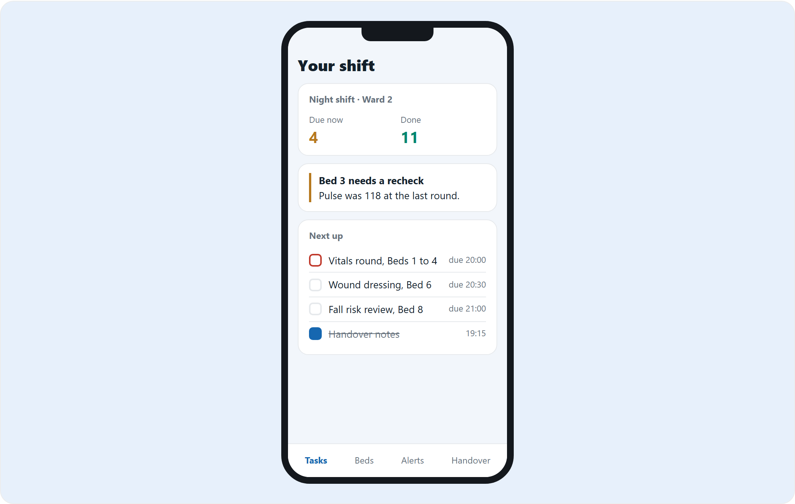

# Example: nurse assistant

A mobile application for a shift. It lists the rounds that are due and records vitals.



*Mock-up with sample data.*

## Resources

| On screen | Resource | Notes |
|---|---|---|
| Rounds | `routine` | Raises a task for each occurrence |
| Task list | `task` | Assigned to a role or a person |
| Vitals entry | `observation` | Attributed to the nurse |
| Team | `care_team` | Roles come from a `care_team` definition |

## Build the data

```python
from clinestra import Actor, Harness

h = Harness()
SITE = "hospital_1"
dr = Actor(id="dr_rao", site=SITE, role="clinician")
nurse = Actor(id="nurse_a", site=SITE, role="nurse")

patient = h.create(dr, "patient", {
    "name": "M. Khan", "country": "IN", "gender": "male", "age_years": 63,
})

# A daily vitals round, from the core pack.
routine = h.create(nurse, "routine", {
    "patient_id": patient.id,
    "definition_key": "ward_vitals",
})

# Create the tasks that are due. Running it again creates no duplicates.
h.run_routines(nurse)
h.run_routines(nurse)
tasks = h.list(nurse, "task", patient.id, status="open")
assert len(tasks) == 1

# Record the vitals and close the task.
h.create(nurse, "observation", {
    "patient_id": patient.id, "code": "pulse", "value": 118, "unit": "/min",
})
h.transition(nurse, "task", tasks[0].id, "done", "Round complete")
assert h.list(nurse, "task", patient.id, status="open") == []
```

## Build the screen

| Part | API | UI component |
|---|---|---|
| Next up | `GET /v1/tasks?status=open` | `TaskBoard` |
| Create due tasks | `POST /v1/routines/run`, on a schedule | None |
| Vitals | `POST /v1/observations` | Your own form |
| Complete | `POST /v1/tasks/{id}/transition` | `ConceptView` |

Call `POST /v1/routines/run` from a scheduled job on the server, not from each phone.

## Prompt

```text
Build a mobile-first nurse shift application in React and TypeScript on the Clinestra API.
Read the Clinestra docs first: api_basics, ui_components and example_nurse_assistant.

Screens:
1. Shift: counts of due and completed tasks, then open tasks for the signed-in nurse's role, overdue first.
2. Round: for one task, a form for vitals. Saving creates observations and marks the task done.
3. Handover: tasks still open, with notes.

Design for one-handed use at 375px width, with large touch targets. Show when the device is offline and do not queue clinical writes silently.

Rules:
- The API is the source of truth. Do not generate tasks in the client. A server job calls POST /v1/routines/run.
- Nurses cannot make clinical decisions. Do not show controls for them.
- When the API refuses a request, show its error message.

Include a seed script based on the Python in example_nurse_assistant, and a README with run steps.
```
