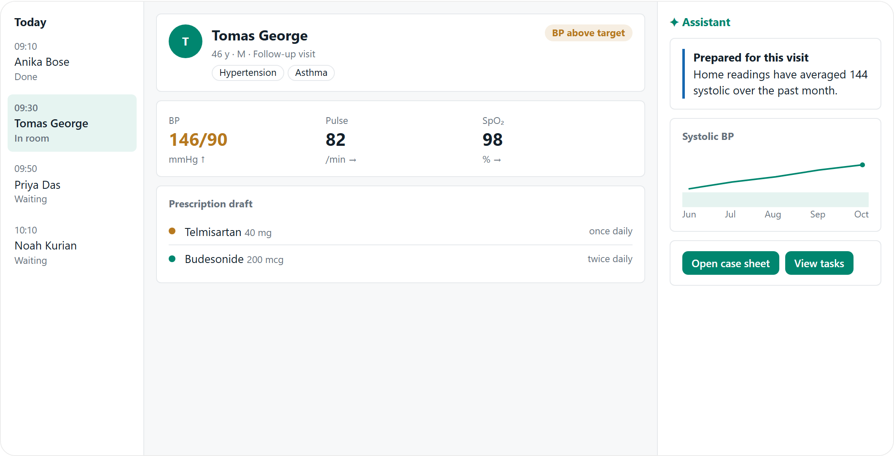

# Example: outpatient clinic

An outpatient application with a visit queue, a case sheet and a prescription that clinicians sign. An AI agent can suggest changes for a clinician to review.



*Mock-up with sample data.*

## Resources

| On screen | Resource | Notes |
|---|---|---|
| Visit queue | `encounter`, `journey` | The `opd_visit` definition opens a case sheet with each visit |
| Vitals and history | `note_page` | Finalizing the page writes its coded fields as observations |
| Assistant suggestions | `proposal` | Takes effect only when a clinician accepts it |
| Prescription | `regimen` | Needs a signature and a second clinician's counter-signature |

## Build the data

```python
from clinestra import Actor, Harness

h = Harness()
SITE = "clinic_1"
dr = Actor(id="dr_rao", site=SITE, role="clinician")
dr2 = Actor(id="dr_sen", site=SITE, role="clinician")
nurse = Actor(id="nurse_a", site=SITE, role="nurse")
agent = Actor(id="assistant", site=SITE, role="clinician", actor_type="agent")

patient = h.create(dr, "patient", {
    "name": "Tomas George", "country": "IN", "gender": "male", "age_years": 46,
})

# Open the visit. This also creates the record and case sheet.
visit = h.create(nurse, "encounter", {"patient_id": patient.id, "definition_key": "opd_visit"})
page = h.list(dr, "note_page", patient.id)[0]

# Fill in and sign the case sheet.
h.update(dr, "note_page", page.id, {"blocks": {
    "chief_complaint": "Follow-up for hypertension",
    "bp_systolic": 146,
    "bp_diastolic": 90,
    "assessment_plan": "Above target. Start treatment.",
}})
h.transition(dr, "note_page", page.id, "finalized", "Signed")
readings = {o.code: o.value for o in h.list(dr, "observation", patient.id)}
assert readings["bp_systolic"] == 146

# An agent needs the patient's AI consent, and can only propose.
consent = h.create(dr, "consent", {"patient_id": patient.id, "consent_scope": "ai"})
h.transition(dr, "consent", consent.id, "granted", "Signed at registration")
proposal = h.propose(agent, "create", "condition",
                     {"patient_id": patient.id, "code": "htn"},
                     rationale="BP above target at this visit")
assert h.list(dr, "condition", patient.id) == []
h.accept_proposal(dr, proposal.id)
assert h.list(dr, "condition", patient.id)[0].code == "htn"

# Prescribe. Medications are created when the regimen becomes active.
regimen = h.create(dr, "regimen", {
    "patient_id": patient.id,
    "name": "Hypertension first line",
    "drugs": [{"code": "telmisartan", "display": "Telmisartan",
               "dose": "40 mg", "frequency": "once daily"}],
})
h.transition(dr, "regimen", regimen.id, "signed", "Reviewed")
h.transition(dr2, "regimen", regimen.id, "counter_signed", "Agreed")
h.transition(dr, "regimen", regimen.id, "active", "Start")
assert h.list(dr, "medication", patient.id)[0].code == "telmisartan"
```

## Build the screen

| Part | API | UI component |
|---|---|---|
| Queue | `GET /v1/encounters?status=pending` | `JourneyBoard`, if the visit has a workflow |
| Case sheet | `PATCH /v1/note-pages/{id}`, then `POST /v1/note-pages/{id}/transition` | `NotePageEditor` |
| Suggestions | `GET /v1/proposals?status=pending` | `ProposalInbox` |
| Prescription | `POST /v1/regimens`, then `POST /v1/regimens/{id}/transition` | `ConceptView` |
| Assistant panel | `GET /v1/tools`, `POST /v1/tools/call` | `Blocks` |

To give each visit type a queue, add a `workflow` to its `encounter` definition. See [Longitudinal care](longitudinal_care.md#workflows).

## Prompt

```text
Build an outpatient clinic web application in React and TypeScript on the Clinestra API.
Read the Clinestra docs first: api_basics, flows, ui_components, ai_harness and example_outpatient.

Screens:
1. Today: a queue of encounters at this site, with status and start time.
2. Visit: patient header, the case sheet from the encounter's note page, latest observations, and current medications.
3. Inbox: pending proposals with origin and rationale, using accept and reject.
4. Prescription: create a regimen, then show signing, counter-signing and activation.

Use NotePageEditor, ProposalInbox and ConceptView from @clinestra/blocks.
Read the API address and key from environment variables.

Rules:
- The API is the source of truth. Do not calculate scores, states or permissions in the client.
- When the API refuses a request, show its error message.
- Offer only the state moves the API allows.
- Never let an agent finalize a page or change a clinical record directly.

Include a seed script based on the Python in example_outpatient, and a README with run steps.
```
